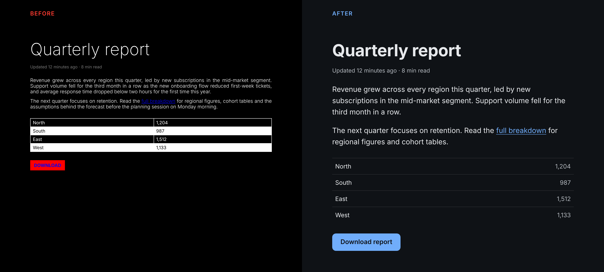
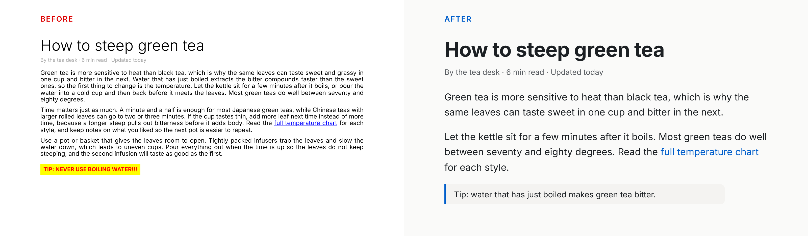
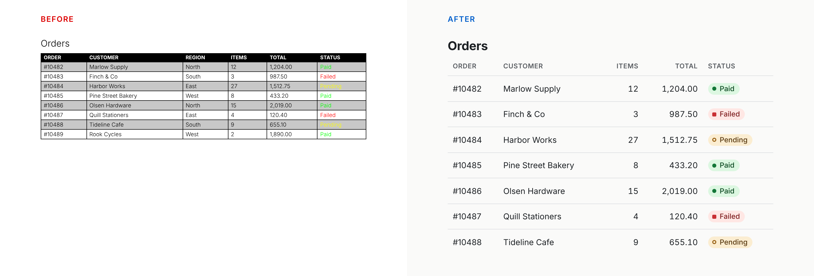
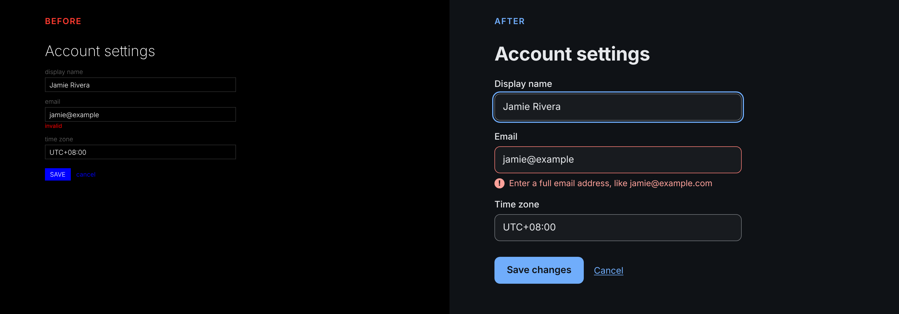

# Easy on the Eyes

[](https://skills.sh/ckmirafss/easy-on-the-eyes)

An agent skill that makes websites comfortable to look at for hours. Literally.

```bash
npx skills add ckmirafss/easy-on-the-eyes
```



## What it does

Design skills make an interface look good, and accessibility audits check the legal minimum. This one checks whether the page is tiring to read.

It gives your coding agent 25 rules for text size, contrast, light and dark themes, motion, stripe patterns and layout stability. Each rule is marked `research`, `standard`, `convention` or `inference`, so you can tell a measured effect from a design habit.

It also ships a small audit script that catches the things linters miss: pure black on pure white, tiny body text, animation with no reduced-motion handling, disabled zoom, autoplay video, and more.

## Use it

Once installed, the skill applies itself when you build or style UI. You can also call it directly.

| Command | What happens |
|---|---|
| `/easy-on-the-eyes` | Applies the comfort defaults to the UI you are working on |
| `/easy-on-the-eyes audit` | Reports problems by severity and changes nothing |
| `/easy-on-the-eyes fix` | Fixes errors first, then warnings, and reports what changed |

The audit script also runs on its own. It needs Node 18 or later and has no dependencies.

```bash
node skills/easy-on-the-eyes/scripts/audit.mjs ./src
node skills/easy-on-the-eyes/scripts/audit.mjs ./src --json
node skills/easy-on-the-eyes/scripts/audit.mjs contrast "#a0a0a0" "#121212"
node skills/easy-on-the-eyes/scripts/audit.mjs contrast "#8a8f98" "#ffffff" --min 3
```

```
Easy on the Eyes audit: src
2 files scanned. 8 errors, 15 warnings, 7 notes.

Errors (8)
  index.html:4  type-rem-zoom  [standard]  matched: maximum-scale=1
    <meta name="viewport" content="width=device-width, initial-scale=1, maximum-scale=1, user-scalable=no">
    Why: Blocking pinch zoom removes the reader's main way to enlarge text (WCAG 1.4.4).
    Fix: Remove user-scalable=no and any maximum-scale below 5.
  ...
```

## What the research says

Most eye strain at a screen comes from things a website cannot touch: how often you blink, how close the screen is, whether your glasses are right, how the room is lit. A website controls one thing, which is how much extra visual work it asks for.

So this skill does not promise to prevent eye strain, and it stops your agent from writing copy that does. The honest claim is that the design does not add avoidable strain.

Some of the findings go against common advice:

- Text size matters more than anything else on the list. 16px sits right at the edge where reading starts to slow down, so treat it as the minimum.
- Blue-light filtering makes little or no difference to eye strain. What matters is how bright the screen is.
- Dark mode is not easier on the eyes. Dark text on light is more legible for most people, and studies find no fatigue difference between the two. Some people need one and some need the other, so ship both.
- No study shows that pure black on pure white causes strain. The skill still recommends softer values, and it labels that rule as convention.
- Gray text that passes the 4.5:1 contrast check can still read weak on a dark background.

The full ledger of what is supported, what is habit and what is myth is in [`references/evidence.md`](skills/easy-on-the-eyes/references/evidence.md), with links to every source.

## What is inside

```
skills/easy-on-the-eyes/
  SKILL.md                         rules, modes and the report format
  references/
    contrast-and-color.md          contrast floors, dark themes, accents
    typography.md                  size, line length, spacing, fonts
    motion.md                      flashing, autoplay, reduced motion
    layout-and-patterns.md         stripes, tables, density, layout shift
    theming.md                     light and dark, toggles, Tailwind and shadcn/ui
    evidence.md                    supported, convention, myth
  scripts/audit.mjs                static audit and contrast checker
  assets/tokens.css                starter tokens for light, dark and dim themes
```

## Before and after

Each pair is the same content. The left side breaks rules the skill checks, and the right side is what it steers toward. The figures are WCAG contrast ratios measured with the skill's own script.

**Long-form article.** 12px justified text running the full width, a 2.32:1 byline and a red-on-yellow callout, against 19px text at about 70 characters per line.



**Data table.** Black grid lines on heavy zebra rows, with status shown by color alone (the green is 1.21:1 on its gray row and the yellow is 1.07:1 on white), against hairlines and status labels that pair a shape with text.



**Form in dark mode.** Field borders at 1.46:1, an error that only says "invalid" in pure red, and no visible focus, against 3.87:1 borders, a clear error message and an 8.14:1 focus ring.



## Works with

Any agent that reads the [Agent Skills](https://agentskills.io) format, including Claude Code, Codex, Cursor, Gemini CLI and GitHub Copilot. The skill uses only the standard frontmatter fields and makes no network calls.

Claude Code users can also install it as a plugin:

```
/plugin marketplace add ckmirafss/easy-on-the-eyes
/plugin install easy-on-the-eyes@easy-on-the-eyes
```

It works alongside a design skill and a WCAG audit. It does not replace either.

## Limits

- The script reads source files with pattern matching. It cannot see the rendered page, and it misses sizes set in `em` or the `font` shorthand. Every report ends with a list of what it could not verify, such as real contrast over images, line length, flash rate and layout shift.
- The contrast checker uses the WCAG 2 formula. For a second opinion on dark themes, use the APCA readout in Chrome DevTools. APCA code is not bundled because of its license.
- The defaults are tuned for Latin scripts.
- Pixel figures for stripe patterns come from geometry, not from tests on web pages. The skill labels them as inference.

## Development

```bash
node tests/run.mjs
```

The tests run the script against a deliberately bad page, a clean page full of near misses and a page that tries to fool the project-level checks. They also check the contrast maths against known values and validate the skill's frontmatter.

If a rule is wrong or I missed a study, open an issue with the source and I will update it.

## License

MIT. Built by [Blackbyrds Digital](https://blackbyrds.digital).
